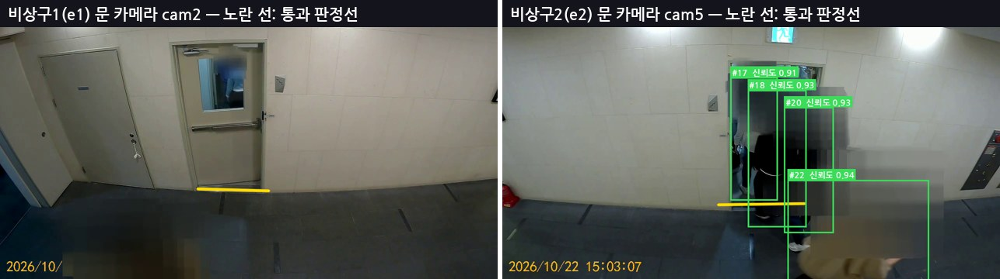
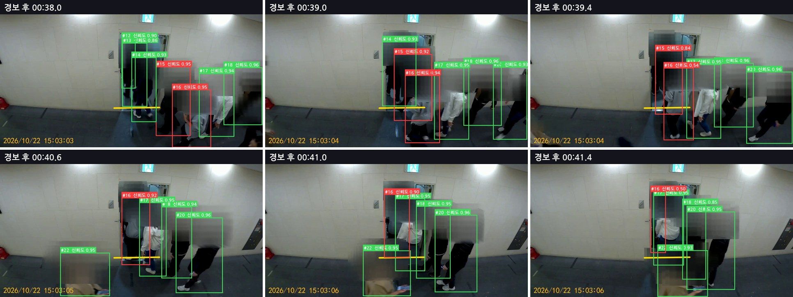
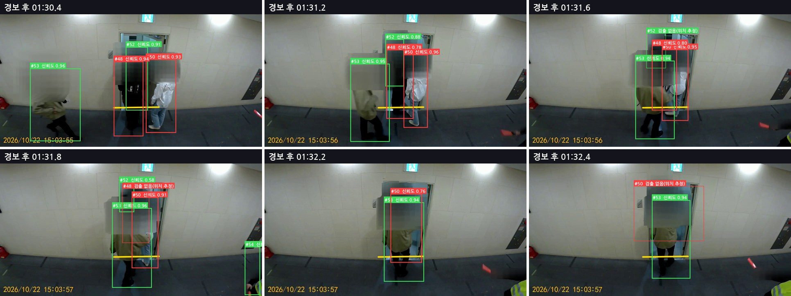
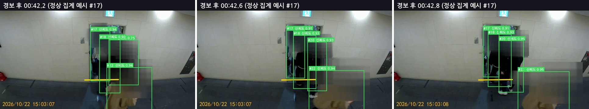
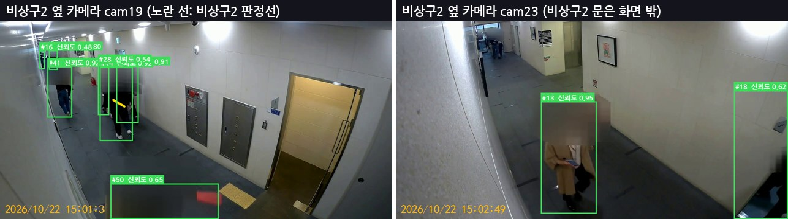

# 피난대피훈련 17층 비상구2 통과 인원 집계 오차 원인 분석 결과 보고

| 항목 | 내용 |
|---|---|
| 문서번호 | PIA-CLAB-202610　　-02 |
| 시행일자 | 2026. 10. 26. |
| 제　　목 | CJ제일제당센터 피난대피훈련(2026. 10. 22.) 17층 비상구2 통과 인원 집계 오차 원인 분석 결과 보고 |

---

## 1. 개요

가. **목　　적**: 피난훈련 평가 결과 중 17층 비상구2의 통과 인원 집계값이 육안 계수값과 5명 차이 나는 원인을
확인하고, 원인별 개선 방안을 제시함.

나. **분석 대상**: 17층 비상구2(오른쪽 계단 출입문)의 경보 후 00:00 ~ 03:30(17층 피난층 종료 시각) 통과 인원

다. **분석 자료**

| 구분 | 내용 |
|:-:|---|
| 녹화 세션 | sess-1792821419865 (17층 단독, 프레임 손실 없는 재생 녹화) |
| 영상 | 17층 카메라 9대 중 비상구2 관련 3대(cam5 문 정면, cam19·cam23 복도) 및 비교용 비상구1 문 정면(cam2) |
| 기준값 | 사람 육안 계수값(근사 정답) — 비상구1 68명, 비상구2 19명 |
| 분석 설정 | 평가 보고서와 같은 설정(판정 여유 1.0 m, 카메라 간 중복 제거 2초, 분석 초당 5프레임, 검출 신뢰도 기준 0.5) |

라. **분석 방법**

1) 녹화 세션을 평가 보고서와 같은 설정으로 다시 재생하여 비상구2 판정선을 통과한 이벤트를 카메라·추적 번호별로 추출함.

2) 비상구2 앞 1 m 안까지 접근하였으나 통과로 집계되지 않은 추적을 찾아, 해당 시각의 영상 화면과 검출 신뢰도를 대조함.

3) 같은 층에서 집계값이 기준값과 일치한 비상구1과 문 앞 혼잡도, 가림 정도, 다른 카메라의 보완 여부를 비교함.

## 2. 분석 결과 요약

| 비상구 | 기준값(육안) | 시스템 집계 | 차이 | 문 정면 카메라 단독 | 다른 카메라가 추가한 인원 |
|:-:|:-:|:-:|:-:|:-:|:-:|
| 비상구1 | 68 | 68 | 0 | cam2: 65 | cam15·cam7: 3 |
| 비상구2 | 19 | 14 | **-5** | cam5: 14 | cam19·cam23: 0 |

가. 비상구2의 미집계 5명 중 **4명은 영상으로 확인**하였음. 4명 모두 문 바로 앞까지는 높은 신뢰도(0.73 ~ 0.96)로
검출되었으나, **앞사람과 겹친 상태로 문틀 안으로 들어서는 순간 검출이 끊겨** 판정선 통과로 기록되지 않았음.

나. 비상구1도 문 정면 카메라 단독으로는 65명으로 기준값보다 3명 적었으나, 다른 각도의 카메라 2대가 이를 보완하였음.
비상구2는 복도 카메라 2대가 문 통과 순간을 독립적으로 관측하지 못하여 **보완된 인원이 없었음**.

다. 따라서 오차의 주된 원인은 **비상구2의 카메라 배치(문 정면 카메라 1대에만 의존하는 구성)**이며,
문틀에서 겹친 사람을 놓치는 **검출 모델의 한계**가 함께 작용한 것으로 판단함.

라. 나머지 1명은 영상으로 특정하지 못하였음. 기준값이 육안 근사 계수값(±2 ~ 3명 수준의 오차 가능)이므로
기준값 쪽 오차일 가능성도 있음.

## 3. 상세 분석

### 가. 판정 방식

1) 시스템은 사람의 발 위치를 도면 좌표로 변환한 뒤, 이 위치가 복도 쪽에서 계단 쪽으로 **판정선(문턱)을 넘을 때**
1명으로 집계함.

2) 판정선을 넘는 시점의 관측은 검출 신뢰도가 기준(0.5) 이상이어야 함. 신뢰도가 기준에 못 미치거나 검출 없이
위치 추정값만 남은 관측은 오검출 방지를 위해 집계에 쓰지 않음.

3) 비상구2 판정선은 문 정면 카메라(cam5) 화면에서 문 바로 아래 바닥 경계에 놓여 있음(그림 1).

### 나. 미집계 인원 확인

| 순번 | 경보 후 시각 | 추적 번호(cam5) | 문 앞까지 신뢰도 | 판정선 통과 시점의 상태 | 그림 |
|:-:|:-:|:-:|:-:|---|:-:|
| 1 | 00:39.4 | #15 | 0.76 ~ 0.95 | 판정선 0.17 m 앞에서 검출 종료(앞사람과 문틀에 가려짐) | 그림 2 |
| 2 | 00:41.2 | #16 | 0.90 ~ 0.96 | 판정선을 넘은 프레임의 신뢰도가 0.44로 떨어져 기준 미달 | 그림 2 |
| 3 | 01:31.8 | #48 | 0.73 ~ 0.96 | 판정선을 넘은 프레임에 검출 없음(위치 추정값만 존재) | 그림 3 |
| 4 | 01:32.4 | #50 | 0.76 ~ 0.96 | 판정선을 넘은 프레임에 검출 없음(위치 추정값만 존재) | 그림 3 |

1) 4명은 모두 줄지어 문으로 들어가는 구간(00:36 ~ 00:48, 01:26 ~ 01:35)에서 발생하였음.

2) 4명 모두 문에 접근하는 동안에는 안정적으로 검출·추적되었음. 사람 자체를 찾지 못하는 일반적인 검출 성능 문제가
아니라, **문틀 안으로 들어서며 다른 사람과 겹치는 1 ~ 2프레임(0.2 ~ 0.4초)**에서만 검출이 끊긴 것임.

3) 정상 집계 사례(#17)는 판정선을 넘은 직후 2프레임 동안 신뢰도 0.91로 검출되어 통과가 기록되었음(그림 4).

### 다. 비상구1과의 비교

| 항목 | 비상구1 (cam2) | 비상구2 (cam5) | 판단 |
|---|:-:|:-:|---|
| 통과 순간 문 앞 1.5 m 안 동시 인원(평균) | 1.20명 | 1.29명 | 비슷함 |
| 문 앞 1 m 안 관측 중 다른 사람과 30% 이상 겹친 비율 | 47% | 41% | 비슷함 |
| 판정선 통과 후 검출이 이어진 프레임 수(평균) | 9.3 | 6.3 | 비상구2가 짧음 |
| 문 정면 카메라의 미집계 | 3명 / 68명 (4%) | 5명 / 19명 (26%) | 비상구2가 많음 |
| 다른 카메라의 보완 | 3명 보완 | 보완 없음 | 결정적 차이 |

1) 문 앞 혼잡도와 가림 정도는 두 비상구가 비슷하였음. 비상구2만 특별히 붐빈 것은 아님.

2) 비상구2는 판정선을 넘은 뒤 화면에 보이는 시간이 짧았음(평균 6.3프레임, 약 1.3초). 문 너머가 곧바로 내려가는
계단이라 몸이 빨리 화면에서 사라지므로, 겹침으로 1 ~ 2프레임만 놓쳐도 통과 시점을 관측할 기회가 없어짐.

3) 비상구1은 다른 각도의 카메라(cam15·cam7)가 문 정면 카메라가 관측하지 못한 통과 3건을 따로 관측하여 기준값과 일치하였음.
비상구2의 복도 카메라 2대는 문 통과 순간을 독립적으로 관측하지 못하였음(그림 5).

- cam19: 복도 반대편 끝에서 비상구2를 멀리 비스듬히 비추어, 문 앞에 줄 선 사람들이 화면에서 더 크게 겹침
- cam23: 비상구2 문이 화면 밖에 있어 문으로 향하는 이동만 관측됨
- 두 카메라가 기록한 통과 7건은 모두 2초 이내의 cam5 통과와 같은 사람으로 짝지어져, cam5 단독 14명에서 늘어난 인원은 없음

### 라. 참고: 이전 설정에서의 집계값

판정 여유·카메라 간 중복 제거를 적용하기 전 설정에서는 비상구2가 18명(차이 -1)으로 집계되었음. 이는 cam5 14명에
복도 카메라 cam19의 4건이 더해진 값인데, 이 4건은 cam5가 이미 집계한 사람을 중복으로 센 것으로 확인되었음
(`media/vsource/cj/drill-1022/docs/선카운트-최적화.md`). 즉 이전 값은 미집계를 중복 집계가 우연히 메운 결과이므로
정확도의 근거로 삼을 수 없음.

## 4. 원인 판단

| 구분 | 해당 여부 | 근거 |
|---|:-:|---|
| **카메라 배치(화각)** | **주원인** | 문 정면 카메라 1대에만 의존. 복도 카메라는 문 통과 순간을 보완하지 못함. 판정선 너머로 보이는 바닥이 짧음 |
| **검출 모델** | 부원인 | 문틀 안에서 다른 사람과 겹친 순간 검출 신뢰도가 떨어지거나 검출이 사라짐(4명 전원) |
| 판정 설정 | 해당 적음 | 권장 설정 주변(판정 여유 0.5 ~ 1.5 m, 중복 제거 1 ~ 3초)에서 비상구2는 일정하게 4 ~ 5명 부족함(설정 시험 결과) |
| 문 앞 혼잡 | 해당 없음 | 혼잡도·가림 정도가 비상구1과 비슷함 |
| 기준값(육안) 오차 | 일부 가능 | 미특정 1명은 기준값 오차일 가능성 있음 |

## 5. 개선 방안

### 가. 카메라 설치(주 대책, 다음 훈련부터 적용)

1) **출구마다 서로 다른 각도의 카메라 2대가 통과 지점을 함께 관측**하도록 배치함. 예를 들어 문 정면 카메라 외에
계단참에서 문을 나오는 방향을 비추는 카메라를 추가함. 한 카메라가 겹침으로 놓쳐도 다른 카메라가 보완할 수 있음
(비상구1에서 확인된 효과).

2) 문 정면 카메라는 **문 위쪽 또는 천장에서 내려다보는 각도**로 설치하여, 줄 선 사람이 화면에서 앞뒤로 겹치지
않게 함.

3) 판정선 너머로 **바닥이 1 m 이상 보이도록** 화각을 조정하여, 통과 후 관측 시간을 확보함.

### 나. 판정 설정(현 녹화 영상으로 시험 가능)

1) 비상구2에 한하여 화면 영역 방식(1층 출구에 적용한 방식) 또는 출구별 검출 신뢰도 기준 완화를 시험할 수 있음.
이번 미집계 4명 중 일부를 회수할 수 있으나, 문 앞에 서 있는 안내 인원 등을 과다 집계할 위험이 있어 기준값 대조
검증 후 적용하여야 함.

2) 분석 프레임 수(현재 초당 5프레임)를 높이면 통과 순간을 관측할 기회가 늘어남. 다만 처리 부하가 증가함.

### 다. 검출 모델(보조 대책)

1) 출입문처럼 사람이 겹치는 장면을 추가 학습하거나, 머리 검출 모델을 함께 사용하여 겹친 사람의 검출을 보강함.

2) 다만 통과 순간이 화면에서 짧게 보이는 배치에서는 모델 개선만으로 한계가 있으므로, 가항의 설치 개선과 병행하여야 함.

## 6. 참고 사항

가. 기준값은 사람이 영상을 보며 센 근사값으로, ±2 ~ 3명 수준의 오차가 있을 수 있음.

나. 분석 수치는 평가 보고서와 같은 녹화 세션·설정으로 산출하였으며, 다시 재생하면 같은 값이 나옴.

다. 본 문서의 그림은 비식별 처리(머리 영역 모자이크)한 영상으로 작성하였음.

라. 분석 자료: `data/통과이벤트_17층.json`(판정선 통과 이벤트 전체), `data/분석요약.json`(표의 수치)

---

## [참고] 그림

### 그림 1. 비상구별 문 정면 카메라와 판정선 위치

노란 선이 통과 판정선임. 두 비상구 모두 문 바로 아래 바닥 경계에 판정선이 있음.

### 그림 2. 미집계 사례 1·2 (경보 후 00:38 ~ 00:41, cam5)

빨간 상자(#15, #16)가 미집계 인원임. #15는 00:39.4에 판정선 앞에서 검출이 끊겼고, #16은 00:41.2에 판정선을 넘었으나
신뢰도가 0.44로 떨어져 집계되지 않았음.

### 그림 3. 미집계 사례 3·4 (경보 후 01:30 ~ 01:32, cam5)

추적 #48은 01:31.8, #50은 01:32.4에 판정선을 넘었으나 그 프레임에 검출이 없어(위치 추정값만 존재) 집계되지 않았음.
두 사람 모두 다른 사람과 겹친 상태로 문틀 안에 들어섬.

### 그림 4. 정상 집계 사례 (경보 후 00:42, cam5)

추적 #17은 판정선을 넘은 뒤에도 신뢰도 0.91로 검출되어 정상 집계되었음.

### 그림 5. 비상구2 복도 카메라의 화각

cam19는 비상구2를 복도 끝에서 멀리 비추고(노란 선), cam23은 비상구2 문이 화면 밖에 있음. 두 카메라 모두 문 통과
순간을 독립적으로 관측하기 어려운 배치임.
